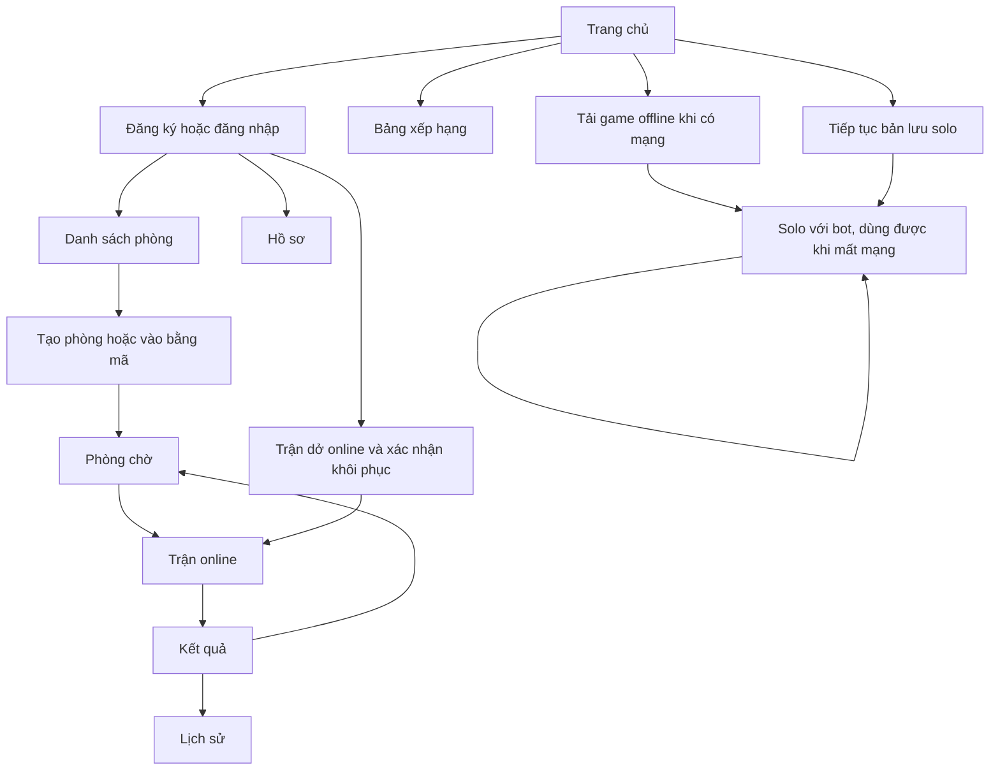

# 00. Kế hoạch tổng thể đồ án Tank Battle Web

Tài liệu kế hoạch gốc được lưu để tham khảo; trạng thái triển khai và kiểm chứng hiện tại xem [STATUS](STATUS.md). Các câu TODO/chưa triển khai bên dưới thuộc thời điểm lập kế hoạch.

Phiên bản kế hoạch: 1.2 — ngày 20/10/2026. Trạng thái: **đã lập kế hoạch, chưa triển khai ứng dụng**.

## 1. Kết quả cần bàn giao

Một website game xe tăng 2D có tài khoản, phòng chơi online và chế độ solo offline. Nhóm có **4 người phát triển**; cấu hình sản phẩm ban đầu đề xuất **2–4 người chơi mỗi phòng**.

Sản phẩm bàn giao gồm mã nguồn có comment, tài liệu luồng và database, game chạy tại local, website HTTPS trên máy chủ, pipeline CI/CD và báo cáo kiểm thử thực tế. Lịch tham chiếu là **8 tuần** với phạm vi bổ sung lưu/khôi phục và xếp hạng; sẽ điều chỉnh khi có hạn nộp và thời lượng làm việc của nhóm.

Đọc tài liệu này để hiểu toàn bộ sản phẩm; dùng [backlog](07-backlog-va-nghiem-thu.md) để nhận và theo dõi việc. Các tài liệu 01–06 giải thích sâu từng phần.

## 2. Danh sách chức năng bản nộp đầu tiên — P0

P0 là các chức năng bắt buộc hoàn thành để nghiệm thu bản đầu.

| Mã  | Nhóm chức năng         | Hành vi người dùng cần có                                                                                      |
| --- | ---------------------- | -------------------------------------------------------------------------------------------------------------- |
| F01 | Trang chủ và hướng dẫn | Chọn chơi online/offline, đọc luật và phím điều khiển, thấy trạng thái tải offline                             |
| F02 | Đăng ký                | Nhập username, tên hiển thị, mật khẩu và xác nhận mật khẩu; nhận lỗi tại trường sai                            |
| F03 | Đăng nhập/đăng xuất    | Đăng nhập bằng username/mật khẩu, giữ phiên khi chuyển trang, đăng xuất kết thúc phiên và kết nối liên quan    |
| F04 | Hồ sơ cá nhân          | Xem username, tên hiển thị, đổi tên hiển thị; xem số trận thắng/thua/hòa đã lưu                                |
| F05 | Danh sách phòng        | Xem tên phòng, chủ phòng, số ghế, trạng thái; cập nhật lại danh sách; biết phòng nào vào được                  |
| F06 | Tạo phòng              | Nhập tên phòng, chọn sức chứa 2/3/4; nhận mã phòng, tự trở thành chủ phòng                                     |
| F07 | Vào phòng              | Vào từ danh sách hoặc nhập mã; xử lý mã sai, phòng đầy, đang chơi và đang ở phòng khác                         |
| F08 | Phòng chờ              | Xem thành viên, ghế, chủ phòng, trạng thái kết nối; sao chép mã; bật/tắt sẵn sàng                              |
| F09 | Quản lý phòng          | Rời phòng; chuyển chủ khi chủ rời; đóng phòng trống; tự dọn thành viên mất kết nối quá hạn                     |
| F10 | Bắt đầu trận           | Chủ phòng bắt đầu khi đủ người, tất cả sẵn sàng và kết nối hợp lệ; chống bắt đầu trùng                         |
| F11 | Game online            | Di chuyển, bắn, tường, va chạm, HP, đồng hồ; máy chủ quyết định diễn biến và kết quả                           |
| F12 | Mất mạng và rời trận   | Hiển thị kết nối lại; lấy state mới khi nối lại; thoát chủ động được tính bỏ cuộc                              |
| F13 | Kết quả và chơi tiếp   | Hiển thị thắng/thua/hòa, lý do kết thúc; về phòng chờ, reset ready và bắt đầu trận mới                         |
| F14 | Lịch sử                | Xem danh sách trận của mình, mở chi tiết, xem đối thủ, thời gian và kết quả; phân trang                        |
| F15 | Solo offline           | Không cần tài khoản; chọn 1–3 bot, chơi trận mới, chơi lại, lưu kết quả gần nhất trên thiết bị                 |
| F16 | Tải game offline       | Tải đủ tài nguyên, xác nhận sẵn sàng; đóng/mở lại hoặc reload khi ngắt mạng vẫn chơi được                      |
| F17 | Triển khai và CI/CD    | Build/test khi thay đổi code; đóng gói image; triển khai bản đã kiểm tra lên HTTPS                             |
| F18 | Tài liệu và vận hành   | Hướng dẫn local/deploy, comment, sơ đồ, test, backup/restore và rollback có bằng chứng                         |
| F19 | Lưu/chơi tiếp trận dở  | Solo lưu trên thiết bị; online có checkpoint bền vững, khôi phục sau server restart và xác nhận người tham gia |
| F20 | Xếp hạng người chơi    | Bảng điểm online, thống kê, đồng hạng, phân trang và vị trí của mình; kết quả khôi phục không cộng trùng       |

Hồ sơ và thống kê lấy từ kết quả online FINISHED. Trận ABORTED hiển thị lý do gián đoạn, không cộng thắng/thua/hòa. Kết quả offline được ghi riêng trên thiết bị.

### Hạng mục bổ sung — P1/P2

| Ưu tiên | Hạng mục                                                   | Điều kiện đưa vào                                                        |
| ------- | ---------------------------------------------------------- | ------------------------------------------------------------------------ |
| P1      | Chủ phòng sửa tên/sức chứa; mời thành viên ra khi đang chờ | P0 đã ổn; bổ sung quyền, reset ready và kiểm thử đồng thời               |
| P1      | Đổi mật khẩu có xác nhận mật khẩu hiện tại                 | Có thiết kế cập nhật phiên/kết nối và kiểm thử vô hiệu hóa phiên phù hợp |
| P1      | Tìm/lọc phòng, âm thanh, bộ lọc xếp hạng theo mùa          | Không làm trễ các mốc online, offline, khôi phục và deploy               |
| P2      | Quên mật khẩu qua email, xác minh email, trang quản trị    | Cần thêm dịch vụ email, token và quyền quản trị                          |
| P2      | Nhiều bản đồ, cảm ứng, bot online, chat                    | Đánh giá lại thời gian và kiểm thử                                       |

P1/P2 không phải điều kiện nghiệm thu P0. Nếu thay phạm vi, cập nhật backlog và ước lượng trước khi thực hiện.

## 3. Màn hình và điều hướng

| Màn hình         | Nội dung và hành động chính                                                   | Trạng thái cần thiết kế                                                          |
| ---------------- | ----------------------------------------------------------------------------- | -------------------------------------------------------------------------------- |
| Trang chủ        | Online, offline, hướng dẫn, đăng nhập/hồ sơ                                   | Khách/đã đăng nhập; game offline chưa tải/đang tải/sẵn sàng/lỗi                  |
| Đăng ký          | Username, tên hiển thị, mật khẩu, xác nhận                                    | Rỗng, dữ liệu sai, username trùng, thành công                                    |
| Đăng nhập        | Username, mật khẩu, chuyển tới đăng ký                                        | Sai thông tin, hết phiên, đang gửi                                               |
| Hồ sơ            | Thông tin cơ bản, sửa tên hiển thị, thống kê                                  | Lưu thành công/thất bại, chưa có trận                                            |
| Danh sách phòng  | Bảng phòng, tạo phòng, nhập mã, trở về phòng đang tham gia                    | Đang tải, chưa có phòng, phòng đã thay đổi, mất kết nối                          |
| Tạo phòng        | Tên phòng, sức chứa, tạo/hủy                                                  | Dữ liệu sai, đang tạo, đã ở phòng khác                                           |
| Phòng chờ        | Mã phòng, thành viên, ready, start, rời                                       | Chờ người, chưa ready, đủ điều kiện, mất mạng, phòng đóng                        |
| Bàn chơi online  | Canvas, HP, thời gian, tên người chơi, trạng thái mạng, thoát trận            | Đang nối, đang chơi, đã bị loại, reconnect, đang lưu kết quả                     |
| Kết quả          | Kết quả từng người, lý do, về phòng/lịch sử                                   | Đã lưu, đang lưu, lưu lỗi, trận gián đoạn                                        |
| Lịch sử/chi tiết | Danh sách có phân trang và chi tiết trận đã tham gia                          | Chưa có dữ liệu, trận không tồn tại/không có quyền                               |
| Solo offline     | Chọn bot, bắt đầu, tạm dừng, chơi lại, kết quả cục bộ                         | Cache chưa đủ, đang chơi, tạm dừng, kết thúc                                     |
| Tiếp tục trận    | Solo thấy bản lưu cục bộ; online thấy trận dở/checkpoint và người đã xác nhận | Đang lưu, lưu lỗi, đang khôi phục, chờ người, hết hạn, bản lưu không tương thích |
| Bảng xếp hạng    | Hạng, tên hiển thị, điểm, thắng/thua/hòa, tỷ lệ thắng, hạng của mình          | Chưa có trận hợp lệ, đồng hạng, phân trang, lỗi tải                              |

Ưu tiên giao diện máy tính có bàn phím. Dùng cùng layout và thông báo nhất quán cho toàn bộ trang. Hộp xác nhận chỉ đặt ở hành động có thể làm bỏ cuộc như rời trận đang chơi.

## 4. Quyền truy cập

Chủ phòng là quyền theo từng phòng, không phải vai trò quản trị toàn hệ thống.

| Hành động                       | Khách         | Người đăng nhập                 | Thành viên đúng phòng                 | Chủ đúng phòng                                 |
| ------------------------------- | ------------- | ------------------------------- | ------------------------------------- | ---------------------------------------------- |
| Xem hướng dẫn, tải/chơi offline | Có            | Có                              | Có                                    | Có                                             |
| Xem bảng xếp hạng public        | Có            | Có                              | Có                                    | Có                                             |
| Xem hồ sơ/lịch sử của mình      | Cần đăng nhập | Có                              | Có                                    | Có                                             |
| Xem danh sách, tạo/vào phòng    | Cần đăng nhập | Có, theo điều kiện              | Một phòng hoạt động/tài khoản         | Một phòng hoạt động/tài khoản                  |
| Xem/subscribe trạng thái phòng  | Không         | Chưa đủ quyền                   | Có                                    | Có                                             |
| Ready và rời phòng              | Không         | Chưa đủ quyền                   | Có                                    | Có                                             |
| Bắt đầu trận                    | Không         | Không                           | Không                                 | Có, khi đủ điều kiện                           |
| Gửi input                       | Không         | Chưa đủ quyền                   | Chỉ điều khiển xe của mình trong trận | Chỉ điều khiển xe của mình trong trận          |
| Xem chi tiết trận cũ            | Không         | Chỉ trận đã tham gia            | Theo danh sách người tham gia trận    | Theo danh sách người tham gia trận             |
| Xem/xác nhận khôi phục online   | Không         | Chỉ trận đã tham gia, còn quyền | Người còn sống xác nhận               | Cùng điều kiện, không tự quyết thay người khác |

Kiểm tra quyền tại backend cho cả HTTP, SEND và SUBSCRIBE; ẩn nút trên giao diện chỉ là hỗ trợ sử dụng. Khi rời phòng, đóng/hủy các kết nối hoặc subscription liên quan để không tiếp tục nhận trạng thái cũ.

## 5. Các luật nghiệp vụ cần thống nhất

### Tài khoản

- Username được chuẩn hóa để tránh hai tài khoản chỉ khác chữ hoa/thường; bản đầu không đổi username.
- Tên hiển thị được phép trùng, có độ dài giới hạn, hiển thị dưới dạng text được escape.
- Mật khẩu và xác nhận phải khớp; backend kiểm tra giới hạn phù hợp với PasswordEncoder, băm trước khi lưu; không log mật khẩu.
- Đăng ký thành công chuyển tới đăng nhập; đăng nhập thành công tới phòng đang tham gia nếu có, nếu không tới danh sách phòng.
- Truy cập trang online cần quyền khi hết phiên chuyển tới đăng nhập; input WebSocket của phiên hết hạn bị từ chối.
- Đăng xuất đóng WebSocket của phiên tương ứng và kết thúc session. Thành viên mất kết nối được dọn theo quy tắc phòng/trận; không giữ kết nối cũ chỉ vì handshake từng hợp lệ.

### Phòng

- Tên phòng 3–40 ký tự; sức chứa 2–4; map và luật cố định ở P0.
- Mã phòng ngắn, duy nhất, dùng để mời/vào phòng. Backend vẫn kiểm tra tài khoản và tư cách thành viên ở mọi thao tác.
- Phòng có bốn trạng thái lưu: WAITING, RUNNING, RECOVERING, CLOSED. Phòng đầy vẫn là WAITING; RECOVERING giữ chỗ cho đúng người của trận dở và không nhận người mới.
- Một tài khoản có tối đa một membership hoạt động. Một người không chiếm nhiều ghế khi bấm/gửi lặp.
- Đủ ít nhất hai người, mọi thành viên ready và có kết nối hợp lệ thì chủ phòng mới start được.
- Danh sách người hoặc cấu hình phòng thay đổi thì reset ready; khi trở về sau trận cũng reset ready.
- Chủ rời phòng chờ thì chuyển quyền cho người vào sớm nhất, hòa thời gian thì theo ghế. Nếu chủ chủ động rời giữa trận, cũng cập nhật chủ cho các thành viên còn lại để phòng chờ kế tiếp có người quản lý; quyền chủ không làm thay đổi luật trận. Phòng không còn thành viên được đóng.
- Ở phòng chờ, mất kết nối quá 60 giây thì tự rời; trước thời hạn có thể kết nối lại bằng cùng tài khoản. Thành viên mất kết nối không đủ điều kiện bắt đầu.

### Trận và kết quả

- Quy tắc di chuyển, đạn, máu và thắng/thua nằm ở [tài liệu 01](01-pham-vi-va-luat-choi.md).
- Online không tạm dừng khi một người mất mạng. Có 30 giây reconnect, xe dừng điều khiển nhưng vẫn có thể bị bắn.
- Chủ động chọn rời trận là bỏ cuộc ngay. Runtime loại xe và membership được giải phóng; không được vào lại như một xe mới trong trận đó.
- Xe bị loại vẫn được xem phần còn lại nếu người chơi chưa rời phòng. Kết nối lại không hồi sinh.
- Lưu kết quả đúng một lần. Trong khi lưu, phòng vẫn RUNNING và UI hiển thị đang lưu; sau commit phòng về WAITING hoặc CLOSED nếu không còn thành viên.
- Nếu tất cả ngắt kết nối trong lúc server vẫn chạy và hết thời hạn, trận ABORTED. Khi server khởi động lại, trận chuyển RECOVERING từ checkpoint, chờ xác nhận theo [tài liệu 08](08-luu-khoi-phuc-va-xep-hang.md); chỉ ABORTED nếu không thể khôi phục, bị hủy hoặc hết hạn chờ. Không tự tính chiến thắng do server restart.
- Một người bỏ cuộc/đã bị loại là thua nếu trận có kết quả FINISHED; người còn lại thắng, hoặc hòa giữa những người còn sống khi hết giờ. ABORTED không cộng thống kê.

### Offline

- Chạy trong JavaScript của trang, không cần session, API hoặc database để hoàn thành trận.
- Sau lần tải thành công khi có mạng, mở lại được khi offline; có kiểm tra đầy đủ trước khi báo sẵn sàng.
- Solo được tạm dừng; quay lại tab không nhảy thời gian mô phỏng hoặc làm xe chạy tiếp ngoài ý muốn.
- IndexedDB giữ một slot dở dang để tiếp tục và tối đa 20 kết quả gần nhất trên thiết bị. Lỗi/xóa bộ nhớ cục bộ được báo rõ; game vẫn có thể chơi nhưng khả năng lưu/tiếp tục có thể không còn.
- Trở lại online tạo hoặc vào trận online mới. Điểm offline không đưa vào thống kê online.

## 6. Dữ liệu và giới hạn vận hành

Sáu bảng chính: users, rooms, room_players, matches, match_players, match_snapshots. Lịch sử/ranking lấy từ người tham gia và kết quả trận; checkpoint dùng cho khôi phục, không thay thế kết quả chính thức. Schema và transaction chi tiết ở [tài liệu 02](02-kien-truc-va-du-lieu.md) và [tài liệu 08](08-luu-khoi-phuc-va-xep-hang.md).

Một Spring Boot instance xử lý các phòng, PostgreSQL giữ dữ liệu lâu dài và checkpoint định kỳ từ state trong RAM. Sau restart/deploy, trận có thể tiếp tục từ checkpoint đã commit; trong lúc chờ phục hồi đồng hồ được dừng. Chuẩn bị VPS Linux, DNS, HTTPS, volume và backup theo [tài liệu 05](05-cicd-va-trien-khai.md).

## 7. Kế hoạch tám tuần và cổng nghiệm thu

| Tuần | Thành quả bắt buộc                                                          | Kiểm tra trước khi chuyển mốc                                                |
| ---- | --------------------------------------------------------------------------- | ---------------------------------------------------------------------------- |
| 1    | Project, schema đầu, CI, trang chủ, thiết kế màn hình và hợp đồng giao tiếp | Máy mới chạy theo README; có trang thử trên HTTPS                            |
| 2    | Đăng ký/đăng nhập, danh sách/tạo/vào phòng; game solo có bot bước đầu       | Hai tài khoản ở cùng phòng; solo có thể kết thúc một trận                    |
| 3    | Lobby/ready, engine Java và solo JavaScript/bot                             | Luật hai engine đúng fixture; phòng và quyền message hoạt động               |
| 4    | Start, đồng bộ trận online, đủ ghế, kết quả bước đầu                        | Hai browser thấy cùng trận; chơi xong và chơi lại được                       |
| 5    | Reconnect/bỏ cuộc, lịch sử; cache offline, lưu solo/checkpoint online       | Đóng tab mở lại solo tiếp tục được; checkpoint PostgreSQL được ghi đúng      |
| 6    | Khôi phục online sau restart, phiên bản bản lưu, lỗi lưu và idempotency     | Cắt process đột ngột rồi phục hồi cùng matchId; không hồi sinh người bỏ cuộc |
| 7    | Hồ sơ, xếp hạng, CD, backup/restore/rollback và đo tải                      | Điểm đúng, không cộng trùng sau khôi phục; deploy và phục hồi dữ liệu đã thử |
| 8    | Sửa lỗi, comment/tài liệu, báo cáo và diễn tập                              | Toàn bộ P0 nghiệm thu có bằng chứng, bản nộp gắn release                     |

Mỗi tuần tích hợp vào main và chạy cùng nhau một phiên. Phân công A/B/C/D và đầu việc có phụ thuộc ở [tài liệu 04](04-lo-trinh-nhom-4-nguoi.md) và [backlog](07-backlog-va-nghiem-thu.md).

## 8. Quy tắc hoàn thành một đầu việc

1. Đạt các tình huống chấp nhận trong backlog, bao gồm lỗi/quyền liên quan.
2. Code có tên rõ, comment giải thích điểm khó, cấu hình mới có hướng dẫn.
3. Các kiểm tra cần thiết chạy đạt; cập nhật tài liệu theo hành vi thực tế.
4. Một thành viên khác review và chạy thử; merge sau khi CI đạt.
5. Ghi bằng chứng vào đầu việc: commit/PR, ảnh hoặc log test, phiên bản môi trường đã kiểm tra.

Chỉ đánh dấu hoàn thành dựa trên kết quả chạy thực tế. Hiện các đầu việc ứng dụng đều ở trạng thái chưa làm.

## 9. Rủi ro và cách xử lý trong kế hoạch

| Điểm khó                                               | Cách giảm rủi ro                                                      | Người phối hợp |
| ------------------------------------------------------ | --------------------------------------------------------------------- | -------------- |
| Java và JavaScript lệch luật                           | Dùng chung rules/map/fixture và cùng thứ tự xử lý                     | B + C          |
| Tranh ghế, start/lưu kết quả trùng                     | Transaction, khóa/index, tính idempotent và test đồng thời            | A + B          |
| Offline chỉ chạy trên tab đang mở                      | Kiểm thử đóng tab/reload sau khi ngắt mạng và dừng backend            | C + D          |
| Deploy HTTPS được nhưng WebSocket lỗi                  | Đưa demo kết nối lên máy chủ sớm, kiểm tra Origin/session/proxy       | B + D          |
| Bản lưu thiếu state, ghi đè trễ hoặc không tương thích | Checkpoint có phiên bản, ghi tuần tự, test crash và migration bản lưu | A + B + C      |
| Điểm bị cộng hai lần sau phục hồi                      | Giữ matchId, kết quả idempotent, ranking tính từ FINISHED             | A + B          |
| Trễ tiến độ vì mở rộng chức năng                       | Giữ P0 làm điều kiện nộp; P1/P2 chỉ nhận khi có thời gian             | Cả nhóm        |
| Nhóm lệch mức độ hiểu                                  | Review chéo và mỗi tuần trình bày một luồng xuyên suốt                | Cả nhóm        |

## 10. Năm việc bắt đầu ngay khi bước sang triển khai

1. Xác nhận luật xe tăng, 2–4 ghế và lịch tương đối với hạn nộp thực tế.
2. Gán tên bốn thành viên vào A/B/C/D; chuyển backlog thành issue.
3. Tạo Spring Boot + Gradle Wrapper, cấu hình dev/test/prod và Compose PostgreSQL.
4. Làm trang chủ, đăng ký/đăng nhập, migration đầu và CI.
5. Deploy trang thử nghiệm; song song dựng Canvas solo và fixture luật.
