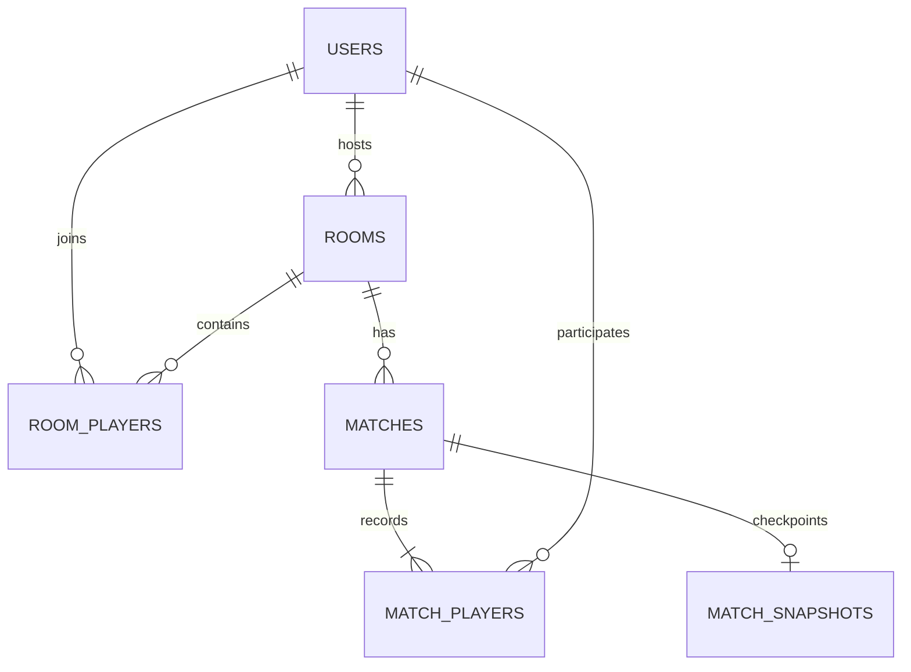

# 02. Kiến trúc và dữ liệu

Tài liệu có phần thiết kế ban đầu chưa triển khai. Schema thật nằm trong db/migration; trạng thái và khác biệt hiện tại xem STATUS/HANDOFF.

## 1. Công nghệ và trách nhiệm

| Công nghệ                         | Làm gì trong đồ án                                                  |
| --------------------------------- | ------------------------------------------------------------------- |
| Java 21 + Spring Boot             | HTTP, tài khoản, phòng, engine online, lưu dữ liệu                  |
| Thymeleaf                         | Render trang chủ, đăng nhập, danh sách phòng, phòng chờ, lịch sử    |
| HTML Canvas + JavaScript thuần    | Vẽ bàn chơi, đọc bàn phím, hiển thị snapshot, chạy engine offline   |
| Spring WebSocket trực tiếp        | Truyền input và trạng thái phòng/trận; handler còn cần hoàn thiện   |
| Spring Security                   | Đăng nhập bằng session, phân quyền HTTP và WebSocket                |
| Spring Data JPA + PostgreSQL      | Lưu dữ liệu nghiệp vụ, transaction khi tạo/vào phòng và lưu kết quả |
| Flyway                            | Quản lý các phiên bản schema bằng migration SQL                     |
| Service Worker + web app manifest | Tải trước game offline, quản lý phiên bản tài nguyên                |
| IndexedDB                         | Lưu state solo dở dang và kết quả cục bộ, không cần backend         |
| Docker Compose + GitHub Actions   | Đóng gói, kiểm tra và triển khai                                    |

Source hiện pin Spring Boot 3.5.16 và Java 21 trong build.gradle. Boot quản lý dependency Spring tương thích; không tự trộn phiên bản Security/Data từ tutorial. Thiết kế ban đầu từng đề xuất Boot 4.1.1; khi triển khai đã chọn nhánh 3.5 để dùng springdoc 2.8.x. Đọc build.gradle và STATUS làm mốc khi tiếp tục, không suy phiên bản từ kế hoạch cũ.

PostgreSQL 17.x là lựa chọn bảo thủ còn được hỗ trợ. Chốt bản vá cụ thể khi triển khai và ghi lại trong cấu hình. [PostgreSQL versioning policy](https://www.postgresql.org/support/versioning/).

## 2. Hai nơi chạy luật game

**Online:** trình duyệt gửi ý định như đi trái hoặc bắn. Java kiểm tra và tính trạng thái thật; trình duyệt nhận snapshot để vẽ. Không nhận tọa độ, HP hay người thắng do client tự khai.

**Offline:** JavaScript tự tính toàn bộ chuyển động, bot, đạn, va chạm và kết quả. HTML offline là file tĩnh, không cần render Thymeleaf khi mở lại.

Vì yêu cầu dùng Java online và chạy độc lập trong trình duyệt offline, bản đầu có hai bản triển khai luật: Java và JavaScript. Để giảm sai khác:

1. Dùng chung `maps/arena-01.json` và `game-rules.json` trong tài nguyên ứng dụng.
2. Viết luật bằng hàm nhỏ, cùng quy tắc thời gian và thứ tự xử lý.
3. Dùng các fixture JSON đầu vào/đầu ra chung để kiểm tra chuyển động, sát thương và điều kiện kết thúc ở cả hai engine.
4. Gắn `rulesVersion` cho cấu hình và `protocolVersion` cho giao tiếp online.

Client offline có thể sửa điểm trên thiết bị. Các kết quả này không được dùng làm kết quả online.

## 3. Vòng lặp game online

- Mốc thử ban đầu: cập nhật mô phỏng 20 lần/giây, gửi snapshot 10 lần/giây.
- Vẽ bằng `requestAnimationFrame`; có thể nội suy giữa hai snapshot để chuyển động dễ nhìn.
- Các con số là cấu hình thử nghiệm, cần đo trên máy chủ thật.
- Một luồng game xử lý tuần tự các phòng đang chạy; handler WebSocket chỉ kiểm tra đầu vào rồi đưa vào hàng đợi có giới hạn.
- Dùng timestep cố định, giới hạn số bước bù khi máy chậm. Không cho hàng đợi hoặc vòng bù tăng vô hạn.
- Input có sequence; bỏ input cũ/trùng. Hết khoảng 500 ms không nhận input hợp lệ thì về trạng thái không bấm phím.
- Giới hạn tần suất và kích thước message, cooldown và số đạn đang tồn tại.
- Không gọi database trong từng tick. Tạo checkpoint bất biến mỗi khoảng 2 giây rồi ghi bằng hàng đợi riêng; lưu bền vững khi bắt đầu, bỏ cuộc và kết thúc.
- Tạo snapshot bất biến trước khi chuyển sang luồng gửi; không serialize trực tiếp đối tượng đang bị engine sửa.

Engine Java là các lớp Java thông thường, không phụ thuộc HTTP/JPA. Engine JavaScript cũng tách khỏi Canvas/DOM để kiểm thử được.

STOMP được Spring hỗ trợ để gửi message theo destination và phát trạng thái tới người đăng ký. Với bản đầu một instance, dùng simple broker trong ứng dụng. [Spring STOMP overview](https://docs.spring.io/spring-framework/reference/web/websocket/stomp/overview.html).

## 4. Dữ liệu lưu và dữ liệu tạm

| Lưu trong PostgreSQL                       | Giữ trong bộ nhớ ứng dụng                           |
| ------------------------------------------ | --------------------------------------------------- |
| Tài khoản, password hash                   | Tọa độ xe, đạn, cooldown                            |
| Phòng, ghế, chủ phòng, trạng thái sẵn sàng | Input, hàng đợi lệnh, snapshot                      |
| Trận, người tham gia, kết quả              | WebSocket session, thời gian chờ reconnect          |
| Checkpoint đủ state để khôi phục           | Runtime hiện tại dựng lại từ checkpoint sau restart |

Bản đầu chạy một instance, session đăng nhập trong bộ nhớ. Sau restart cần đăng nhập lại; tìm trận RUNNING/RECOVERING và nạp checkpoint, giữ membership/phòng để xác nhận tiếp tục. Chỉ ABORTED nếu bản lưu không dùng được, bị hủy hoặc hết thời gian chờ. Không tự đóng các phòng đang phục hồi. Giữ nguyên kết quả FINISHED; không cấu hình nhiều replica khi chưa thiết kế quyền sở hữu runtime/broker. [Thiết kế khôi phục chi tiết](08-luu-khoi-phuc-va-xep-hang.md).

## 5. Schema đề xuất

| Bảng              | Trường chính                                                                                                                             | Ràng buộc cần chú ý                                                                  |
| ----------------- | ---------------------------------------------------------------------------------------------------------------------------------------- | ------------------------------------------------------------------------------------ |
| `users`           | id, username, password_hash, display_name, created_at                                                                                    | Username chuẩn hóa, unique                                                           |
| `rooms`           | id, code, name, host_user_id, status, capacity, version, created_at                                                                      | Mã phòng unique; tên 3–40 ký tự; capacity 2–4; WAITING/RUNNING/RECOVERING/CLOSED     |
| `room_players`    | id, room_id, user_id, seat, ready, joined_at, left_at                                                                                    | Unique ghế và user đang hoạt động trong phòng                                        |
| `matches`         | id, room_id, status, rules_version, rules_snapshot, map_snapshot, recovery_deadline_at, started_at, ended_at, winner_user_id, end_reason | RUNNING / RECOVERING / FINISHED / ABORTED; winner nullable                           |
| `match_players`   | id, match_id, user_id, seat, outcome, final_hp, disconnected, forfeited_at                                                               | Unique(match_id, user_id); giữ lịch sử và mốc bỏ cuộc bền vững                       |
| `match_snapshots` | match_id, schema_version, tick, payload JSONB, saved_at                                                                                  | PK/FK match_id; một checkpoint mới nhất, ghi theo tick tăng dần và trạng thái hợp lệ |

`room_players` giữ lịch sử rời phòng qua `left_at`. Dùng partial unique index với điều kiện `left_at IS NULL` cho `(room_id, seat)`, `(room_id, user_id)` và `user_id` để bảo đảm một người chỉ ở một phòng hoạt động. Seat phải nằm trong giới hạn sức chứa. Bản đầu chỉ lưu trận online trong PostgreSQL; bot offline không cần bản ghi users.



ERD thể hiện quan hệ chính; nullable winner và các index cần ghi cụ thể trong migration. Lưu thời gian dạng UTC, hiển thị theo múi giờ người dùng khi cần.

Hồ sơ, thống kê và bảng xếp hạng được truy vấn từ match_players kết hợp matches FINISHED; chưa cần bảng bộ đếm riêng. Trận RECOVERING/ABORTED không cộng thành tích. Trận FINISHED ghi WIN/LOSS/DRAW, gồm LOSS cho người bỏ cuộc. Công thức đề xuất là 3 điểm/thắng, 1 điểm/hòa, 0 điểm/thua; chi tiết đồng hạng/phân trang ở tài liệu 08. Chi tiết trận kiểm tra quyền theo match_players. Sửa tên hiển thị cập nhật users; username giữ nguyên.

## 6. Transaction quan trọng

- Tạo/vào phòng: kiểm tra tài khoản chưa có membership hoạt động; khóa hàng phòng khi cấp ghế; kiểm tra WAITING và số ghế trống trong cùng transaction. Unique index là lớp bảo vệ cuối khi hai yêu cầu đồng thời.
- Bắt đầu: khóa phòng; kiểm tra chủ phòng, thành viên và ready; tạo match/người tham gia/checkpoint đầu trong cùng transaction. Phát sự kiện sau commit. Khởi tạo runtime theo matchId một lần; nếu lỗi thì báo và xử lý khôi phục hoặc ABORTED tùy khả năng dùng bản lưu.
- Kết thúc: đóng băng trận, đưa tác vụ lưu kết quả sang luồng nghiệp vụ; một transaction ghi match và match_players, chống ghi lặp bằng matchId/unique constraint. Thông báo kết quả đã lưu sau commit.
- Checkpoint: hàng đợi ghi tuần tự theo matchId, kiểm tra tick/trạng thái để bản cũ không đè bản mới; mốc bỏ cuộc thay membership và checkpoint liên quan nhất quán trong transaction.
- Nếu lưu kết quả lỗi, hiển thị đang lưu và thử lại có backoff. Khi process chết, nạp checkpoint; nếu bản lưu đã kết thúc thì hoàn thiện kết quả idempotent, nếu còn chơi thì chuyển RECOVERING. Không cộng điểm trước commit.
- Resume: khóa match/phòng, kiểm tra danh tính người còn sống và trạng thái sẵn sàng; chuyển RECOVERING sang RUNNING một lần, gắn đúng một runtime. Restart lại giữ recovery_deadline_at đã có.

Các transaction phải ngắn, dùng cùng thứ tự khóa ở các thao tác liên quan để giảm deadlock. [Spring Data JPA locking](https://docs.spring.io/spring-data/jpa/reference/jpa/locking.html).

## 7. Cấu trúc source đã áp dụng

Gốc chỉ có auth/common/business; business chia tầng chung theo yêu cầu. Cây đầy đủ ở [tài liệu 17](17-quy-hoach-package.md), luồng thực tế ở [tài liệu 20](20-luong-backend-va-test.md).

```text
src/main/java/vn/edu/utc/tankbattle/
  auth/       # Tài khoản, JWT, Google, security/handshake
  common/     # base/entity/request/response/repository, util, errors, validation
  business/
    entity/ dto/request/ dto/response/ controller/ service/ repository/ mapper/
    model/ config/ engine/ runtime/ websocket/
src/main/resources/
  db/migration/    # Flyway V1–V6
  static/          # Rules, content, campaign-stages JSON
  i18n/            # Bundle vi/en
src/test/          # JUnit, JDBC, API, socket, source contracts và test DB guard
tools/             # PostgreSQL test portable và DB check chỉ đọc
.github/workflows/ # CI trên H2/PostgreSQL
.agents/           # Quy ước AI, STATUS/HANDOFF và toàn bộ tài liệu luồng
```

Template, renderer, engine JS, Service Worker/IndexedDB sẽ tạo khi bắt đầu UI. Thư mục rỗng dự kiến không giữ trong source hiện tại. Flyway quản lý schema, JPA chỉ validate. Production Neon chưa chạy migration trong công việc này.
