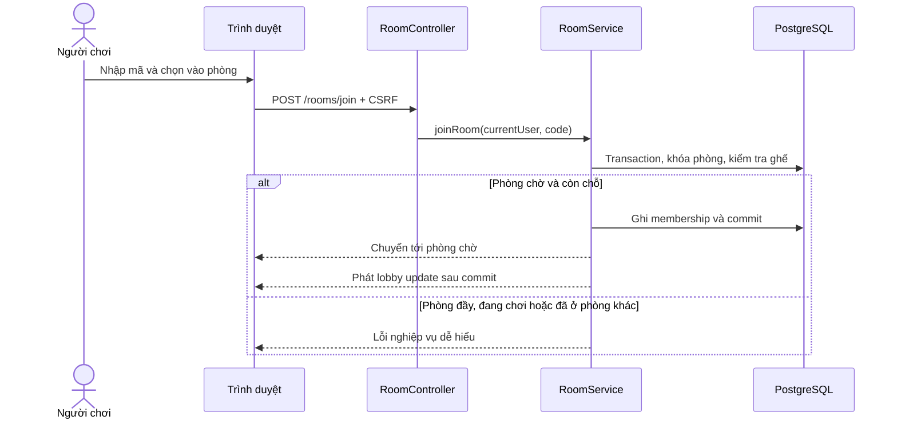
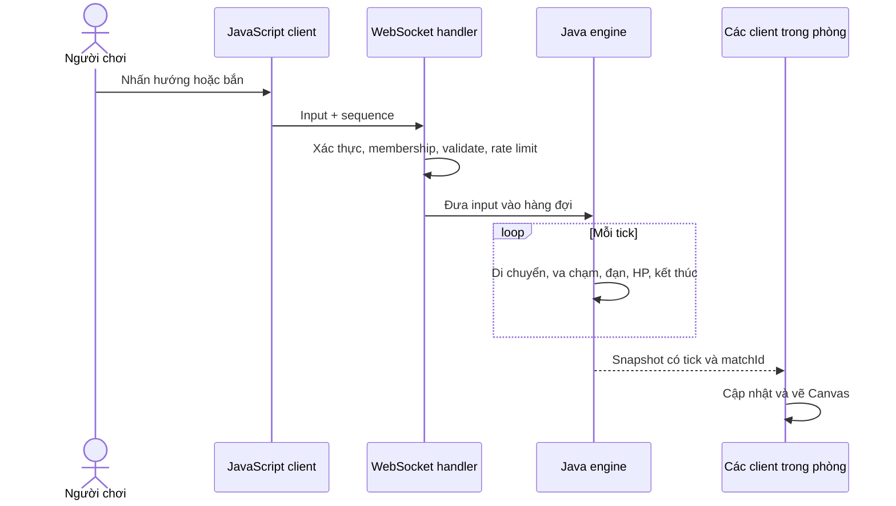
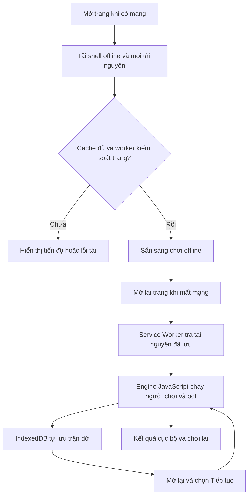

# 03. Luồng xử lý và giao tiếp

Các route, message và tên lớp dưới đây là thiết kế dự kiến, chưa phải API đã triển khai.

## 1. Đăng ký và đăng nhập

1. Người dùng mở trang đăng ký Thymeleaf.
2. Gửi form có CSRF token; backend validate username, mật khẩu và tên hiển thị.
3. Chuẩn hóa username, kiểm tra trùng và băm mật khẩu bằng PasswordEncoder của Spring Security.
4. Lưu tài khoản, chuyển tới trang đăng nhập.
5. Đăng nhập thành công tạo session; HTTP và kết nối WebSocket nhận cùng danh tính.

Không trả password hash về client. Lỗi form được hiển thị cạnh trường liên quan. Trang offline và tài nguyên cần thiết là public, không phụ thuộc session.

Đăng nhập thành công chuyển tới phòng đang tham gia nếu có, nếu không tới danh sách phòng. Hồ sơ cho xem thông tin, sửa tên hiển thị và xem thống kê FINISHED. Đăng xuất/hết phiên cần đóng WebSocket liên quan và từ chối lệnh của phiên cũ; không chỉ xóa cookie trên giao diện. Thành viên mất kết nối sau đó tuân theo thời hạn dọn phòng/reconnect.

## 2. Tạo/vào phòng



Tạo mã phòng phải xử lý va chạm bằng unique constraint và thử mã khác. Bấm vào phòng hai lần không tạo hai ghế. Nếu yêu cầu tham gia cùng phòng được gửi lặp, trả về membership hiện có.

Phòng chờ hiển thị tên thành viên, chủ phòng, trạng thái ready và nút bắt đầu đúng quyền. Nếu WebSocket chưa kết nối, hiển thị trạng thái và chưa cho xác nhận ready.

Khi roster thay đổi, reset ready cho cả phòng. Rời phòng chờ giải phóng ghế; chuyển chủ cho thành viên vào sớm nhất; đóng nếu trống. Mất kết nối lobby quá 60 giây cũng xử lý như rời. Sau khi membership mất hiệu lực phải ngừng các subscription/kết nối liên quan, để người đã rời không tiếp tục đọc trạng thái phòng.

## 3. Bắt đầu trận

1. Chủ phòng gửi yêu cầu start có CSRF token.
2. Service khóa phòng, kiểm tra WAITING, đủ người, tất cả ready và trạng thái kết nối.
3. Dựng state ban đầu với rules/map và spawn hợp lệ; ghi match RUNNING, người tham gia và checkpoint đầu trong cùng transaction.
4. Sau commit, đưa lệnh tạo runtime vào hàng đợi; matchId bảo đảm không tạo hai trận.
5. Runtime nhận state ban đầu đã commit, không tự tạo lại spawn hoặc rules khác với checkpoint.
6. Gửi snapshot đầu tiên và tín hiệu bắt đầu cho đúng thành viên phòng.
7. Client dùng thời gian/tick từ server để hiển thị đồng hồ, không tự quyết định hết trận online.

V1 không cho vào giữa trận. Nếu một người mất mạng ngay khi bắt đầu, áp dụng luật reconnect. Nếu tạo runtime lỗi, abort match và đưa phòng về trạng thái hợp lệ để thử lại.

## 4. Điều khiển và đồng bộ trận online



Client gửi trạng thái phím khi thay đổi và gửi lại định kỳ tối đa khoảng 10 lần/giây. Khi mất focus/ẩn tab, gửi input trung tính và ngừng giữ phím. Server cũng tự trung tính hóa input quá cũ để xe không chạy mãi nếu mất sự kiện nhả phím.

### Message input minh họa

```json
{
  "protocolVersion": 1,
  "matchId": "uuid-cua-tran",
  "sequence": 42,
  "direction": "LEFT",
  "fire": true
}
```

`direction` chỉ nhận UP/DOWN/LEFT/RIGHT/NONE. Người gửi lấy từ Principal của kết nối; không cho client chọn userId. Server kiểm tra matchId thuộc phòng của người gửi, xe còn hoạt động và sequence mới hơn input trước. `fire: true` là ý định giữ phím bắn; engine áp dụng cooldown.

### Snapshot minh họa

```json
{
  "protocolVersion": 1,
  "rulesVersion": "1",
  "matchId": "uuid-cua-tran",
  "tick": 420,
  "status": "RUNNING",
  "remainingMs": 159000,
  "players": [{ "id": "p1", "x": 128, "y": 96, "direction": "LEFT", "hp": 3 }],
  "bullets": []
}
```

Ví dụ rút gọn chỉ có một player. Snapshot thực tế chứa toàn bộ thực thể cần vẽ trong trận. Bỏ snapshot cũ; yêu cầu tải lại khi protocol không tương thích. Không đưa thông tin tài khoản nhạy cảm vào snapshot.

## 5. HTTP và WebSocket dự kiến

| Kênh      | Đường dẫn                                               | Mục đích                                                   |
| --------- | ------------------------------------------------------- | ---------------------------------------------------------- |
| GET       | `/`, `/register`, `/login`                              | Trang chính và tài khoản                                   |
| POST      | `/register`, `/login`, `/logout`                        | Thay đổi trạng thái xác thực                               |
| GET       | `/profile`                                              | Hồ sơ và thống kê của tài khoản hiện tại                   |
| POST      | `/profile`                                              | Chỉ cập nhật tên hiển thị của chính mình                   |
| GET       | `/rooms`, `/rooms/{code}`                               | Danh sách và phòng chờ                                     |
| POST      | `/rooms`, `/rooms/join`                                 | Tạo/vào phòng                                              |
| POST      | `/rooms/{code}/ready`                                   | Bật/tắt sẵn sàng của thành viên hiện tại                   |
| POST      | `/rooms/{code}/start`                                   | Chủ phòng bắt đầu khi đủ điều kiện                         |
| POST      | `/rooms/{code}/leave`                                   | Rời lobby hoặc bỏ cuộc nếu đang trong trận                 |
| GET       | `/matches/{id}`, `/history`                             | Trang trận/kết quả và lịch sử của người dùng               |
| GET       | `/leaderboard`                                          | Xếp hạng public từ kết quả online FINISHED                 |
| GET       | `/matches/resumable`, `/matches/{id}/recovery`          | Trận dở và màn hình xác nhận khôi phục; chỉ người có quyền |
| POST      | `/matches/{id}/resume-ready`                            | Người còn sống xác nhận tiếp tục, cần CSRF                 |
| POST      | `/matches/{id}/cancel-recovery`                         | Hủy khôi phục theo luật, không cộng điểm                   |
| GET       | `/offline/`                                             | HTML tĩnh chơi offline                                     |
| WS        | `/ws`                                                   | WebSocket handshake; STOMP qua WebSocket gốc               |
| SEND      | `/app/rooms/{code}/input`                               | Gửi input vào backend                                      |
| SEND      | `/app/rooms/{code}/sync`                                | Yêu cầu snapshot mới sau reconnect                         |
| SUBSCRIBE | `/topic/rooms/{code}/lobby`, `/topic/rooms/{code}/game` | Nhận trạng thái của phòng được phép                        |
| SUBSCRIBE | `/user/queue/errors`                                    | Lỗi riêng của kết nối                                      |

Khi triển khai, bổ sung DTO, validation và request/response thực tế vào từng route. Lịch sử dùng phân trang; chi tiết trận chỉ cho người đã tham gia. Dùng POST cho thao tác thay đổi dữ liệu, không thay đổi trạng thái bằng GET.

Session HTTP có thể được dùng lại làm danh tính WebSocket. Phải kiểm tra quyền cả SEND lẫn SUBSCRIBE; người đăng nhập không mặc nhiên được xem mọi phòng. Chỉ máy chủ được phát vào `/topic/**`. STOMP CONNECT gửi CSRF token lấy từ trang online, giới hạn Origin về domain ứng dụng. [Spring Security WebSocket security](https://docs.spring.io/spring-security/reference/servlet/integrations/websocket.html).

## 6. Mất kết nối và kết thúc

- Mỗi người chỉ có một kết nối điều khiển hiệu lực; kết nối mới thay kết nối cũ. Chỉ disconnect của kết nối đang hiệu lực mới đánh dấu người đó mất mạng.
- Client thông báo mất kết nối, thử lại có backoff và thời hạn 30 giây. Khi nối lại, kiểm tra session/membership và lấy snapshot đầy đủ.
- Nếu session hết hạn, yêu cầu đăng nhập lại; nếu trận đã kết thúc hoặc xe bị loại, chuyển tới trạng thái tương ứng.
- Chọn rời trận có xác nhận bỏ cuộc: loại xe ngay, giải phóng membership và không cho quay lại như người chơi mới của trận đó. Xe bị loại nhưng chưa rời phòng vẫn có thể theo dõi phần còn lại.
- Nếu người rời là chủ phòng, chuyển quyền cho thành viên còn lại theo thứ tự vào/ghế để quản lý phòng sau trận; không thay đổi engine hoặc kết quả.
- Khi có kết quả, engine ngừng nhận input điều khiển, yêu cầu lưu kết quả một lần. Sau commit gửi kết quả chính thức.
- Trong khi lưu, phòng giữ RUNNING và UI báo đang lưu. Hoàn tất thì về WAITING/reset ready hoặc CLOSED nếu trống. Trận cũ vẫn xem được trong lịch sử của người đã tham gia.
- Process restart: nạp checkpoint và chuyển RECOVERING, giữ phòng/người tham gia, chờ xác nhận rồi tiếp tục cùng matchId. Deadline đề xuất 10 phút; thiếu người/hết hạn/bản lưu lỗi mới ABORTED. Checkpoint đã kết thúc được chốt kết quả idempotent. [Luồng chi tiết](08-luu-khoi-phuc-va-xep-hang.md).

Lỗi nghiệp vụ cần có mã và thông báo: ROOM_FULL, ROOM_NOT_WAITING, NOT_HOST, NOT_READY, NOT_ROOM_MEMBER, INVALID_INPUT, PROTOCOL_MISMATCH. Với form Thymeleaf, giữ dữ liệu nhập hợp lệ và hiển thị thông báo; với WebSocket, gửi lỗi riêng thay vì broadcast lỗi cho cả phòng.

## 7. Luồng tải và chơi offline



Chiến lược thiết kế:

- `sw.js` ở gốc, scope `/`; chỉ quản lý cache cho danh sách tài nguyên public đã định nghĩa.
- Cache shell offline, CSS, toàn bộ module JavaScript phụ thuộc, map, rules, icon và tài nguyên dùng trong game. Thư viện cần chạy offline được phục vụ cùng ứng dụng, không lấy từ CDN.
- Với navigation online thất bại, phục vụ shell offline có lựa chọn chơi solo. Không giả lập response API hoặc thành công của thao tác phòng.
- Không cache trang cá nhân, CSRF token, response API, kết quả POST hoặc dữ liệu đăng nhập.
- Cache gắn releaseId. Bản mới tải đủ trước khi thay bản cũ; thông báo cập nhật và áp dụng ở menu/giữa hai trận.
- Đảm bảo mỗi bản cache giữ tài nguyên tương thích. Không xóa cache cũ khi tab cũ vẫn cần nó.
- `sw.js` cần được kiểm tra cập nhật, tránh cache HTTP quá lâu. Manifest hỗ trợ thêm game vào màn hình chính; không bắt buộc cài để chơi offline trên trình duyệt hỗ trợ.

Tiến trình solo lưu bằng IndexedDB, tách với cache tài nguyên. Online checkpoint ở PostgreSQL, không nhận bản lưu do client tự cung cấp. Bảng xếp hạng lấy từ kết quả FINISHED và cùng matchId sau khôi phục, không cộng điểm cho RECOVERING/ABORTED/offline. Chi tiết ở tài liệu 08.

[MDN: Using Service Workers](https://developer.mozilla.org/en-US/docs/Web/API/Service_Worker_API/Using_Service_Workers) giải thích vòng đời install/activate, cache và scope. Các lựa chọn cache trên là thiết kế dành riêng cho đồ án.
