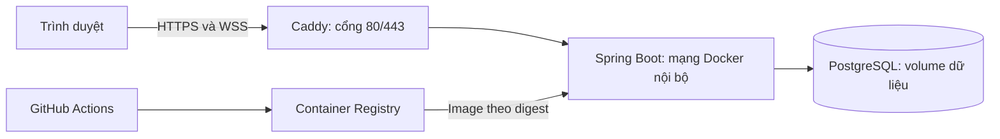
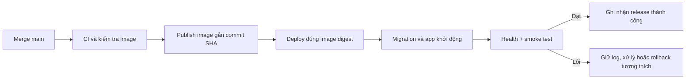

# 05. CI/CD và triển khai

Tài liệu này giữ phương án VPS/Compose của kế hoạch ban đầu và các mục tiêu vận hành dài hạn. Hiện nhóm đã chọn Render Free + Neon, có Dockerfile và workflow thật; cách cấu hình đang áp dụng nằm trong [tài liệu 22](22-github-render-cicd.md), lệnh Gradle nằm trong [tài liệu 23](23-gradle-va-thymeleaf.md). Chưa kiểm chứng deploy public. Không coi các mục UI/browser test bên dưới là đã triển khai.

## 1. Mô hình phù hợp cho bản đầu

Một máy chủ Linux còn được hỗ trợ, chạy Docker Compose với ba dịch vụ:

Lấy 2 vCPU, RAM 4 GB và SSD làm cấu hình dự toán ban đầu để có chỗ cho Java, PostgreSQL và hệ điều hành. Đây không phải cam kết số người chơi; cần đo CPU/RAM và thời gian tick trước khi kết luận sức tải. Chạy build trong CI, máy chủ chỉ kéo image.

Trước khi thuê, so sánh tổng chi phí máy chủ, ổ đĩa, băng thông, backup, tên miền và thời hạn ưu đãi. Kiểm tra hỗ trợ tiến trình chạy liên tục, WebSocket, volume bền vững và quyền quản lý Docker. Chốt nhà cung cấp và giá khi có ngân sách, không giả định gói miễn phí đáp ứng đầy đủ.

Docker có hướng dẫn riêng cho việc chạy Compose trên một server và tách cấu hình production. [Use Compose in production](https://docs.docker.com/compose/how-tos/production/).

## 2. Chuẩn bị lần đầu theo thứ tự

1. Tạo repository GitHub, thống nhất người sở hữu và quyền của bốn thành viên.
2. Chuẩn bị máy chủ Linux, cập nhật hệ điều hành, tài khoản deploy và SSH key.
3. Cài Docker Engine/Compose; tạo thư mục triển khai với quyền truy cập phù hợp.
4. Có tên miền hoặc subdomain; trỏ DNS về máy chủ và kiểm tra bản ghi A/AAAA thực sự dùng được.
5. Mở 80/443 cho website, giới hạn SSH cho người quản trị. Không publish PostgreSQL 5432 hoặc Spring 8080 ra Internet.
6. Tạo cấu hình Compose: `proxy`, `app`, `db`; app không chạy bằng root; có giới hạn tài nguyên, log rotation và restart policy.
7. Tạo volume bền vững cho PostgreSQL và dữ liệu chứng chỉ của Caddy.
8. Thiết lập biến môi trường/bí mật bên ngoài repository; kiểm tra quyền đọc file.
9. Cấu hình Caddy reverse proxy tới app; triển khai trang thử nghiệm và kiểm tra HTTPS, WebSocket.
10. Chạy migration vào database trống, kiểm tra health và đăng nhập thử.
11. Cấu hình backup rồi phục hồi vào database thử trước khi coi hệ thống sẵn sàng.
12. Kết nối pipeline CD, deploy một thay đổi nhỏ và xác nhận phiên bản mới đang chạy.

Caddy hỗ trợ tự cấp/gia hạn HTTPS khi DNS, cổng và lưu trữ đáp ứng điều kiện; reverse proxy hỗ trợ WebSocket. [Automatic HTTPS](https://caddyserver.com/docs/automatic-https), [reverse_proxy](https://caddyserver.com/docs/caddyfile/directives/reverse_proxy).

## 3. Cấu hình cần quản lý

| Nhóm                 | Ví dụ                                                                                | Nơi đặt                                            |
| -------------------- | ------------------------------------------------------------------------------------ | -------------------------------------------------- |
| Public configuration | APP_BASE_URL, APP_IMAGE, SPRING_PROFILES_ACTIVE=prod                                 | Biến môi trường triển khai                         |
| Database             | SPRING_DATASOURCE_URL, username/password; POSTGRES_DB/USER/PASSWORD cho container DB | Secret hoặc file môi trường chỉ người quản trị đọc |
| Giới hạn game        | Số phòng tối đa, tick rate, message size, thời gian reconnect                        | Cấu hình được ghi phiên bản                        |
| Deploy               | SSH host/user/key, host fingerprint, quyền đọc registry nếu image private            | GitHub environment secrets/configuration           |

App và container PostgreSQL phải dùng thông tin database khớp nhau. Spring Boot không tự đọc `.env` như một quy tắc mặc định; Compose phải truyền các biến được khai báo vào container hoặc ứng dụng phải cấu hình cơ chế đọc secret rõ ràng. Với secret dạng file, cấu hình Spring đọc file/config tree tương ứng.

Quyết định mới của chủ đồ án: cho phép commit `.env`/`render.env` và toàn bộ `secrets/` gồm cặp JWT PEM để nhóm dùng chung cấu hình demo. Docker vẫn loại env/key khỏi image, Render nhận key qua Secret Files; CI dùng DB/key test riêng. Không ghi mật khẩu, token, cookie hoặc toàn bộ message nhạy cảm vào log. Quyền `packages: write` dùng cho job publish; job đọc thông thường chỉ cần quyền tối thiểu. [GitHub Actions secrets](https://docs.github.com/en/actions/how-tos/write-workflows/choose-what-workflows-do/use-secrets).

## 4. CI — tự kiểm tra khi thay đổi code

Mỗi pull request và push vào main chạy:

1. Checkout, thiết lập JDK 21, dùng Gradle Wrapper đã pin.
2. Khởi động PostgreSQL test cùng major với production, chờ database sẵn sàng.
3. Chạy `./gradlew --no-daemon clean build`: compile, Java test, integration test và package.
4. Gradle test dùng JUnit Platform; postgresTest chọn rõ AuthSystemTest/BusinessFlowTest và cần PostgreSQL test riêng. Không chỉ đặt tên file rồi giả định test đã chạy.
5. Dùng Node trong CI để chạy kiểm thử JavaScript thuần và fixture luật chung; production không cần Node server.
6. Kiểm thử trình duyệt cho luồng quan trọng: phòng online và tải/làm mới trang offline.
7. Build Docker image, chạy smoke test image với cấu hình test và PostgreSQL tạm.

Lỗi ở bước bắt buộc phải chặn merge/publish. Lưu báo cáo test, log cần thiết và ảnh lỗi thành artifact, không đưa secret vào artifact. [Building and testing Java with Gradle](https://docs.github.com/en/actions/tutorials/build-and-test-code/java-with-gradle).

## 5. CD — đưa bản đã kiểm tra lên máy chủ

- Các PR chỉ kiểm tra; publish/deploy từ nhánh tin cậy sau khi CI đạt.
- Có thể dùng GitHub Container Registry. Tag commit SHA để tra cứu, deploy bằng digest để xác định chính xác image.
- Kiểm tra image xong mới publish/deploy; deploy lại cùng artifact, không build bản khác trên VPS.
- SSH cần xác minh host fingerprint; không bỏ kiểm tra host để làm pipeline chạy qua.
- Serialize các lần deploy, không để hai workflow cùng sửa một môi trường.
- Lưu digest cũ và mới, thời điểm, commit, kết quả migration/health/smoke.
- Deploy chờ database healthy, chạy migration tương thích, khởi động app và chờ readiness trong thời gian giới hạn.
- Smoke test tối thiểu: trang chính, tài nguyên offline, đăng nhập thử trong môi trường test và WebSocket kết nối được.
- Cài policy GitHub Environment phù hợp: đầu tiên có thể chủ động kích hoạt deploy để học; sau đó tự deploy main khi các kiểm tra đạt.

GitHub có hướng dẫn build/publish image và khuyến nghị pin action theo commit SHA. [Publishing Docker images](https://docs.github.com/en/actions/tutorials/publish-packages/publish-docker-images).

Bản đầu một instance có gián đoạn khi deploy. Thông báo bảo trì, ngừng tạo trận mới và ưu tiên chờ trận hiện tại kết thúc; nếu cần dừng sớm, ghi checkpoint cuối trước khi dừng. Sau restart, đưa trận còn dở vào RECOVERING và cho xác nhận tiếp tục. Chưa cam kết triển khai không gián đoạn. Checkpoint định kỳ vẫn cần cho tình huống process chết đột ngột, không chỉ graceful shutdown.

Migration/deploy có kiểm tra tương thích schema checkpoint và rules/map đã lưu. Nếu image mới không đọc được bản lưu cũ, cần migration đã thử hoặc kế hoạch xử lý cụ thể trước deploy; không âm thầm hủy trận. Rollback image cũng cần đọc được định dạng bản lưu do image mới đã ghi.

## 6. Health, log và lỗi thường gặp

- Dùng Actuator health với phản hồi tối thiểu; readiness phải kiểm tra được database. Không public toàn bộ actuator/env/config.
- `depends_on` đơn thuần không chứng minh database sẵn sàng; cần healthcheck/start condition và khả năng kết nối lại của app.
- Docker báo unhealthy không tự khởi động lại container chỉ vì trạng thái đó. Cần cơ chế giám sát/cảnh báo và xử lý được ghi rõ.
- Ghi log theo roomId/matchId/releaseId; không log từng tick ở mức INFO trên production.
- Theo dõi CPU, RAM, dung lượng đĩa, tick trễ, số phòng/kết nối, lỗi DB và chứng chỉ.
- Theo dõi tuổi checkpoint, lỗi ghi/lỗi đọc, số trận RECOVERING và deadline. Nếu checkpoint chậm/lỗi, UI và vận hành phải biết; không coi có volume là đã khôi phục trận được.
- Website mở được nhưng game không nối: kiểm tra HTTPS/WSS, Origin, CSRF CONNECT, reverse proxy và session.
- Offline vẫn thấy bản cũ: kiểm tra releaseId, worker đang active/waiting, danh sách cache và quy tắc cập nhật.

## 7. Backup, restore và rollback

**Backup:** dùng `pg_dump` định kỳ, ghi thời gian/phiên bản, kiểm tra mã thoát, giữ nhiều bản và ít nhất một bản ở nơi khác máy chủ. Bản dump có thể chứa dữ liệu tài khoản nên cần giới hạn quyền và bảo vệ khi lưu/truyền. Volume tồn tại lâu dài không thay thế backup.

**Restore:** phục hồi bản dump vào database thử riêng bằng công cụ phù hợp định dạng dump; tạo role/quyền cần thiết; kiểm tra đăng nhập, lịch sử và số lượng bản ghi. Không thử restore trực tiếp vào database đang phục vụ. [PostgreSQL SQL dump](https://www.postgresql.org/docs/17/backup-dump.html), [pg_dump](https://www.postgresql.org/docs/17/app-pgdump.html).

**Rollback ứng dụng:** đổi về image digest trước đó, khởi động lại app và kiểm tra sức khỏe. Chỉ làm khi schema mới còn tương thích với image cũ. Ưu tiên migration thêm bảng/cột trước, chuyển code sau, dọn cấu trúc cũ ở phiên bản sau.

Rollback image không tự rollback database. Nếu migration phá vỡ tương thích, cần phương án sửa tiến hoặc restore đã diễn tập; quyết định dựa trên dữ liệu mới phát sinh và chấp nhận mất dữ liệu. Không dùng thao tác xóa volume để sửa lỗi deploy.

## 8. Bằng chứng hoàn thành triển khai

- URL HTTPS hoạt động từ máy ngoài mạng phát triển.
- Hai người chơi ở hai máy kết nối cùng phòng được.
- Sau khi tải đầy đủ, mở trang offline khi ngắt mạng vẫn chơi được.
- Có một run CI/CD thành công liên kết tới commit và image digest.
- Tạo lại app container không mất tài khoản/lịch sử đã lưu.
- Có kiểm thử kill/restart ứng dụng rồi khôi phục trận từ PostgreSQL với cùng matchId; bảng điểm không tăng trùng.
- Có biên bản restore/rollback thử; ghi rõ mốc checkpoint, thời gian chờ và độ lùi state có thể xảy ra.
