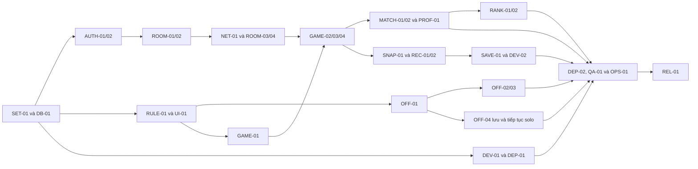

# 07. Backlog triển khai và nghiệm thu

Tài liệu kế hoạch gốc được lưu để tham khảo; trạng thái triển khai và kiểm chứng hiện tại xem [STATUS](STATUS.md). Các câu TODO/chưa triển khai bên dưới thuộc thời điểm lập kế hoạch.

Ngày cập nhật: 20/10/2026, kế hoạch 1.2. Backlog bao gồm P0 lưu/khôi phục cả hai chế độ và xếp hạng; lịch tham chiếu 8 tuần. Chưa có ứng dụng, PR hoặc kết quả kiểm thử.

## 1. Cách sử dụng

- A: backend tài khoản/phòng/database; B: engine Java/WebSocket; C: giao diện/game JavaScript; D: offline cache/CI/CD/tích hợp.
- Người chính chịu trách nhiệm bàn giao; người review kiểm tra và hỗ trợ, không phải một người nhận hết phần kiểm thử/tài liệu.
- Trạng thái dùng khi làm: TODO → IN_PROGRESS → REVIEW → VERIFIED → DONE. VERIFIED cần bằng chứng chạy thực tế; DONE sau merge và kiểm tra môi trường chung phù hợp.
- Hiện mọi đầu việc ứng dụng trong bảng dưới là TODO. Những tài liệu kế hoạch đã tạo không có nghĩa chức năng tương ứng đã chạy được.
- Mốc tuần là thời điểm mục tiêu; khi phụ thuộc chưa xong thì cập nhật lịch, không đánh dấu đạt trước.

## 2. Đầu việc bắt buộc P0

| ID       | Đầu việc / chức năng                          | Chính / review        | Phụ thuộc                                                                     | Mốc   | Tiêu chí chấp nhận                                                                                                                                      |
| -------- | --------------------------------------------- | --------------------- | ----------------------------------------------------------------------------- | ----- | ------------------------------------------------------------------------------------------------------------------------------------------------------- |
| SET-01   | Project, Wrapper, profiles, hướng dẫn local   | A / D                 | —                                                                             | T1    | Build từ bản clone mới; chạy app và DB theo README; không cần secret thật trong Git                                                                     |
| DB-01    | Migration và ràng buộc dữ liệu                | A / B                 | SET-01                                                                        | T1    | Tạo DB trống; username/mã phòng/ghế unique; có match_snapshots, rules/map của trận và RECOVERING; schema được validate                                  |
| DEV-01   | CI Java và PostgreSQL test                    | D / A                 | SET-01, DB-01                                                                 | T1    | PR chạy build và các test được cấu hình; cố tình làm một test lỗi thì job thất bại                                                                      |
| WEB-01   | Trang chủ, layout, hướng dẫn — F01            | C / A                 | SET-01                                                                        | T1    | Điều hướng đến online/offline; luật/phím rõ; trạng thái khách/đã đăng nhập đúng                                                                         |
| DEP-01   | Docker và HTTPS thử nghiệm — F17              | D / B                 | SET-01, DEV-01                                                                | T1    | Một image chạy trên máy chủ; URL HTTPS mở từ máy khác; dữ liệu DB ở volume                                                                              |
| AUTH-01  | Đăng ký — F02                                 | A / C                 | DB-01, WEB-01                                                                 | T2    | Hợp lệ tạo đúng một user; trùng username khác hoa/thường bị từ chối; xác nhận sai không lưu; password được băm                                          |
| AUTH-02  | Đăng nhập/đăng xuất và phiên — F03            | A / B                 | AUTH-01                                                                       | T2    | Đúng thông tin vào được; sai có thông báo; route có quyền chặn khách; logout/hết phiên đóng kết nối liên quan và từ chối lệnh cũ                        |
| ROOM-01  | Danh sách và tạo phòng — F05/F06              | A / C                 | AUTH-02, DB-01                                                                | T2    | Hiển thị tên/chủ/số ghế/trạng thái; tạo tên và capacity hợp lệ; có mã; chủ chiếm một ghế                                                                |
| ROOM-02  | Vào phòng — F07                               | A / B                 | ROOM-01                                                                       | T2    | Vào bằng mã/danh sách; mã sai/đầy/đang chơi có lỗi; tranh ghế cuối chỉ một người vào; gửi lặp không thêm ghế                                            |
| RULE-01  | Rules, map, fixture dùng chung                | B / C                 | SET-01                                                                        | T2    | Chốt tọa độ, timestep, collision và luật thắng; có fixture chuyển động, đạn, cooldown, kết thúc                                                         |
| UI-01    | Canvas, input, HUD                            | C / B                 | WEB-01, RULE-01                                                               | T2    | Vẽ xe/tường/đạn; phím hoạt động; đổi kích thước hiển thị không đổi tọa độ game; mất focus dừng giữ phím                                                 |
| OFF-01   | Engine JavaScript và bot — F15                | C / B                 | RULE-01, UI-01                                                                | T3    | Solo với bot kết thúc/chơi lại được; pause/resume không nhảy mô phỏng; fixture JS đạt                                                                   |
| NET-01   | Kết nối và quyền WebSocket                    | B / A                 | AUTH-02, ROOM-02, RULE-01                                                     | T3    | Danh tính từ session; CONNECT/SEND/SUBSCRIBE đúng quyền; người ngoài không nhận/gửi state phòng; giới hạn input                                         |
| ROOM-03  | Lobby cập nhật và ready — F08                 | A / B                 | ROOM-02, NET-01                                                               | T3    | Các client thấy cùng thành viên/ready; roster đổi thì reset ready; mất kết nối có trạng thái; copy mã có phương án dự phòng                             |
| ROOM-04  | Rời, chuyển chủ, dọn phòng — F09              | A / B                 | ROOM-03                                                                       | T3    | Chủ rời chuyển đúng người; phòng trống đóng; quá 60 giây mất mạng ở lobby thì giải phóng ghế; người đã rời không nhận state mới                         |
| GAME-01  | Engine Java                                   | B / C                 | RULE-01                                                                       | T3    | Luật chuyển động/đạn/HP/kết thúc đúng fixture; không phụ thuộc HTTP/JPA; Java/JS tương đương theo sai số đã chốt                                        |
| GAME-02  | Start và trận online — F10/F11                | B / A                 | ROOM-03, GAME-01, UI-01, NET-01                                               | T4    | Chỉ chủ được start khi đủ điều kiện; gửi lặp chỉ tạo một match; hai client thấy cùng state; input không được tự khai HP/vị trí                          |
| GAME-03  | Cô lập phòng và đủ ghế — F11                  | B / D                 | GAME-02, ROOM-04                                                              | T4    | Phòng 2/3/4 người chạy; người thứ năm không vào; nhiều phòng không lẫn input, snapshot, kết quả                                                         |
| GAME-04  | Reconnect/bỏ cuộc — F12                       | B / D                 | GAME-03                                                                       | T5    | Server vẫn chạy: reconnect dưới 30 giây lấy state thật; quá hạn bị loại; thoát chủ động bỏ cuộc; toàn bộ mất mạng quá hạn thì ABORTED                   |
| MATCH-01 | Lưu kết quả/chơi tiếp — F13                   | A / B                 | GAME-02                                                                       | T4    | Kết quả lưu một lần; retry không nhân đôi; lưu xong reset ready/về lobby; lỗi lưu có trạng thái; chơi được trận kế tiếp                                 |
| MATCH-02 | Lịch sử và chi tiết — F14                     | A / C                 | MATCH-01                                                                      | T5    | Chỉ xem trận đã tham gia; phân trang; thể hiện đối thủ/thời gian/kết quả/RECOVERING/ABORTED; rời phòng không mất lịch sử                                |
| OFF-02   | Cache, worker, trạng thái tải — F16           | D / C                 | OFF-01, WEB-01, DEP-01                                                        | T5    | Tải đủ mới báo sẵn sàng; đóng tab, tắt backend, ngắt mạng rồi mở lại/reload vẫn chơi; không cache trang cá nhân/API                                     |
| OFF-04   | IndexedDB autosave/tiếp tục solo — F19        | C / D                 | OFF-01                                                                        | T5    | Một slot dở, autosave; đóng trình duyệt/mở lại không mạng tiếp tục đúng state/bot/timer; không chỉ lưu khi unload; báo lỗi storage                      |
| OFF-03   | Kết quả cục bộ/cập nhật — F15/F16             | C / D                 | OFF-02, OFF-04                                                                | T5    | Tối đa 20 kết quả IndexedDB; finish ghi kết quả/xóa save atomically; storage lỗi vẫn chơi; cache và save giữ phiên bản tương thích                      |
| SNAP-01  | Checkpoint online bền vững — F19              | B / A                 | GAME-02, DB-01                                                                | T5    | State đủ cho restore; ghi đầu/định kỳ/cuối, ngoài tick; bản cũ không đè bản mới/FINISHED; bỏ cuộc nhất quán membership và checkpoint                    |
| REC-01   | Khôi phục runtime sau restart — F19           | B / A                 | SNAP-01, GAME-04, ROOM-04                                                     | T6    | Kill process, restart nạp checkpoint vào RECOVERING; dừng đồng hồ, giữ deadline, đúng một runtime/cùng matchId, không hồi sinh người bỏ cuộc            |
| REC-02   | Màn hình trận dở và xác nhận — F19            | C / B                 | REC-01, UI-01, AUTH-02                                                        | T6    | Đăng nhập thấy trận dở; đúng người sống xác nhận; đủ người thì tiếp tục; thiếu/hủy/hết hạn thì ABORTED, không tự tạo chiến thắng                        |
| SAVE-01  | Phiên bản/lỗi lưu và crash quanh commit — F19 | A / D                 | SNAP-01, REC-01, OFF-04                                                       | T6    | Validate/migration checkpoint; lỗi DB dẫn tới cảnh báo/tạm dừng phù hợp; restart quanh commit kết quả không làm nhân đôi hoặc xóa mất kết quả đã commit |
| DEV-02   | CI JavaScript/browser/recovery                | D / C                 | GAME-02, OFF-02, OFF-04, REC-02                                               | T6    | CI chạy fixture hai engine và smoke browser; có kiểm thử restart/recovery và đóng/mở lại solo; lỗi thật làm job thất bại                                |
| PROF-01  | Hồ sơ, tên hiển thị, thống kê — F04           | A / C                 | AUTH-02, MATCH-01                                                             | T7    | Chỉ sửa tên của mình; thống kê khớp FINISHED; RECOVERING/ABORTED/offline không cộng; tên được hiển thị an toàn                                          |
| RANK-01  | Tổng hợp điểm và rank — F20                   | A / B                 | MATCH-01                                                                      | T7    | Công thức 3/1/0 đúng dữ liệu mẫu; chỉ FINISHED; đồng hạng và rank cá nhân tính trước phân trang; finish lặp/khôi phục không cộng trùng                  |
| RANK-02  | Trang xếp hạng và hạng cá nhân — F20          | C / A                 | RANK-01, PROF-01, WEB-01                                                      | T7    | Bảng điểm có phân trang, thắng/thua/hòa/tỷ lệ; hạng mình đúng; chưa có trận báo chưa xếp hạng; chỉ public dữ liệu hiển thị                              |
| DEP-02   | Publish và CD — F17                           | D / A                 | DEV-01, DEV-02, DEP-01, GAME-03, OFF-02, REC-02, SAVE-01                      | T7    | CI đạt mới deploy đúng digest; không chồng deploy; health/smoke và tương thích checkpoint được kiểm tra; có release record                              |
| OPS-01   | Backup/restore/rollback — F18                 | D / A                 | DEP-02, MATCH-02, SAVE-01                                                     | T7    | Restore dump sang DB thử; rollback tương thích cả schema DB và checkpoint; phục hồi trận từ bản lưu được; giữ log bằng chứng                            |
| QA-01    | Nghiệm thu xuyên suốt và đo tải               | D / B                 | GAME-04, ROOM-04, MATCH-02, OFF-03, REC-02, SAVE-01, RANK-02, PROF-01, DEP-02 | T7–T8 | Ma trận test gồm crash/resume/rank; đo nhiều phòng và chi phí checkpoint; lỗi chặn luồng chính đã sửa, có kết quả thực                                  |
| DOC-01   | Comment, tài liệu và báo cáo — F18            | A+B+C+D / review chéo | Cập nhật theo từng đầu việc                                                   | T1–T8 | README/sơ đồ/API/schema/save/rank khớp code; báo cáo test, runbook, giới hạn recovery và phân công thực tế                                              |
| REL-01   | Bản nộp và diễn tập                           | Cả nhóm / D tổng hợp  | QA-01, OPS-01, DOC-01                                                         | T8    | Gắn release; demo tài khoản/phòng/game/khôi phục/rank/CI/CD; mỗi người giải thích phần mình và một luồng chung                                          |

DEP-01 cần tài khoản máy chủ, DNS và quyền triển khai do nhóm chuẩn bị. Nếu chưa có vào tuần 1, D hoàn thiện image/Compose và kiểm tra local trước, ghi rõ phần HTTPS còn chờ hạ tầng; không đánh dấu deploy đã đạt.

## 3. Thứ tự ưu tiên khi bắt đầu



Các nhánh độc lập có thể làm song song. Hợp đồng giao tiếp và fixture cần thống nhất sớm, sau đó mỗi người có thể dùng dữ liệu giả lập có cấu trúc đúng trong lúc chờ phần phụ thuộc.

## 4. Mẫu một issue để giao việc

```text
ID: ROOM-02
Tên: Vào phòng từ mã hoặc danh sách
Chức năng: F07
Người chính: A; review: B
Phụ thuộc: ROOM-01
Trạng thái: TODO

Luồng chính:
  Người đã đăng nhập -> chọn phòng/nhập mã -> kiểm tra và cấp ghế
  -> mở phòng chờ -> các thành viên thấy danh sách mới.

Điều kiện chấp nhận:
  - Mã hợp lệ, WAITING, còn ghế: vào thành công.
  - Gửi lặp cùng yêu cầu: giữ một membership.
  - Mã sai, phòng đầy/đang chơi, đã ở phòng khác: báo đúng lỗi.
  - Hai người tranh ghế cuối: chỉ một membership mới được ghi.
  - Người chưa đăng nhập: yêu cầu đăng nhập.

Bằng chứng khi hoàn thành:
  PR/commit; kết quả integration test; ảnh hai client ở cùng phòng.
Tài liệu cập nhật:
  Luồng, URL/DTO thực tế, lỗi và constraint liên quan.
```

## 5. Checklist phát hành P0

- [ ] F01–F20 đều có đầu việc VERIFIED/DONE và bằng chứng tương ứng.
- [ ] Chạy từ clone mới theo README; không dùng cấu hình chỉ tồn tại trên máy một thành viên.
- [ ] Đăng ký → đăng nhập → tạo/vào phòng → ready → chơi → kết quả → chơi lại → lịch sử hoạt động.
- [ ] Các tình huống quyền, phòng đầy, gửi lặp, mất mạng và restart đã được thử.
- [ ] Solo offline hoạt động sau đóng tab/reload khi tắt mạng và backend.
- [ ] Solo khôi phục từ bản lưu; online khôi phục sau kill/restart với cùng matchId, đúng người và đúng deadline.
- [ ] Xếp hạng đúng công thức/đồng hạng/phân trang; không cộng trùng sau khôi phục hoặc tính điểm offline/ABORTED.
- [ ] Phiên bản trên HTTPS xác định được bằng commit/image digest; có pipeline đạt.
- [ ] Backup/restore và rollback tương thích đã được diễn tập.
- [ ] Comment và tài liệu khớp code; nêu rõ những chức năng P1/P2 chưa làm.
- [ ] Bốn thành viên đều chạy thử bản nộp và giải thích được luồng chính.
