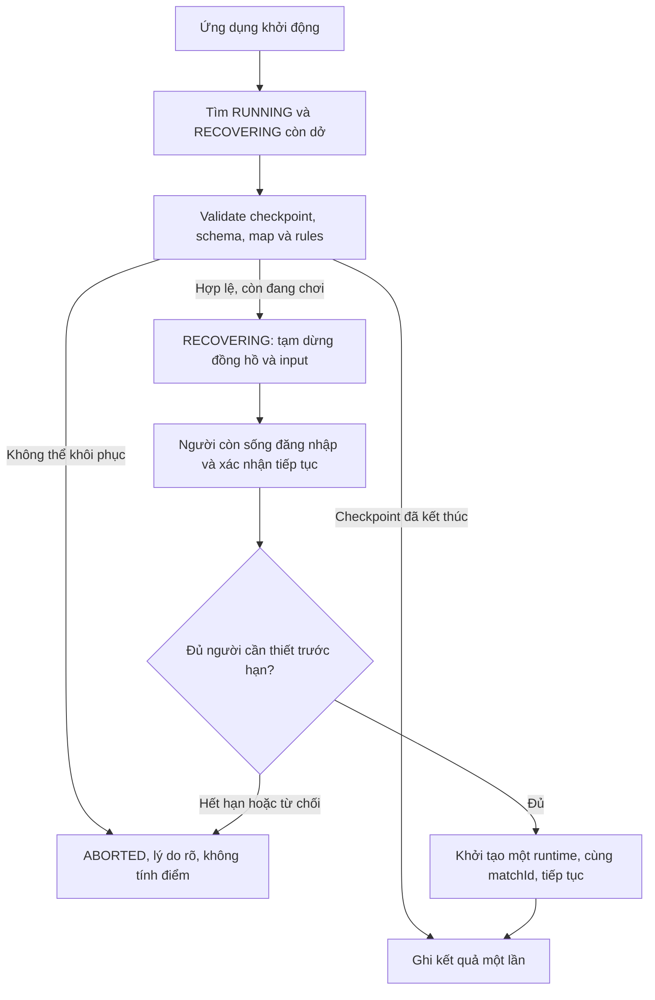

# 08. Lưu trận dở dang, khôi phục và xếp hạng

Phiên bản kế hoạch 1.2 — 20/10/2026. Người dùng đã yêu cầu **khôi phục cả online và offline sau khi đóng trình duyệt hoặc máy chủ khởi động lại**, đồng thời có bảng xếp hạng. Hai nhóm này thuộc P0. Tài liệu này thay thế giới hạn cũ coi mọi trận online sau restart là ABORTED và offline chỉ bắt đầu trận mới.

## 1. Phân biệt các tình huống

| Tình huống                               | Hành vi dự kiến                                                                                 |
| ---------------------------------------- | ----------------------------------------------------------------------------------------------- |
| Đóng/reload trang solo                   | Lần mở sau thấy Tiếp tục trận; dùng bản lưu gần nhất trên cùng thiết bị/trình duyệt             |
| Mất Internet khi solo                    | Game và lưu cục bộ vẫn hoạt động sau khi đã tải đủ tài nguyên                                   |
| Đóng trang online, server vẫn chạy       | Trận vẫn tiếp diễn; đăng nhập lại cùng tài khoản để vào state hiện tại trong thời hạn reconnect |
| Đóng trang online quá lâu                | Giữ luật bỏ cuộc do quá hạn; không quay ngược thời gian hoặc hồi sinh xe đã bị loại             |
| Server restart hoặc app bị dừng đột ngột | Nạp checkpoint đã commit; trận chuyển RECOVERING, chờ các người chơi còn sống quay lại xác nhận |
| Cả trình duyệt và server đều đã đóng     | Khi server lên, người dùng đăng nhập lại; thấy trận cần khôi phục nếu còn trong cửa sổ chờ      |
| Người chơi chọn Rời trận                 | Là bỏ cuộc có chủ đích; không khôi phục tư cách người chơi đã bỏ cuộc                           |

Đề xuất ban đầu: autosave/checkpoint mỗi **2 giây**, reconnect lúc server còn chạy **30 giây**, cửa sổ phục hồi sau restart **10 phút**. Đây là cấu hình đề xuất để chốt khi triển khai, không phải số đo hay yêu cầu thời gian đã được xác nhận.

Khôi phục dùng bản lưu đã commit gần nhất. Khi lưu bình thường, có thể lùi một đoạn ngắn so với frame cuối; nếu lưu bị lỗi, độ trễ lớn hơn và giao diện phải báo rõ. Không cam kết giữ chính xác frame cuối khi thiết bị/process tắt đột ngột.

## 2. Nội dung một bản lưu

Snapshot dùng để vẽ cho client và checkpoint dùng khôi phục là hai DTO khác nhau. Checkpoint cần đủ state để tiếp tục mô phỏng:

- saveId/matchId, schemaVersion, rulesVersion, map/rules của trận.
- Tick mô phỏng, thời gian đã chơi/còn lại, phase và số thứ tự thực thể tiếp theo.
- Xe: người sở hữu, vị trí, hướng, HP, alive, thời gian chờ bắn còn lại.
- Đạn: ID, người bắn, vị trí/hướng, tốc độ, thời gian sống còn lại.
- Bot offline: state điều khiển và state bộ sinh số ngẫu nhiên có thể lưu được.
- Thành viên/ghế và người đã bỏ cuộc/bị loại; trạng thái kết thúc đang chờ lưu nếu có.
- Thời điểm lưu, phiên bản định dạng; các giá trị được validate trước khi nạp.

Không lưu session, mật khẩu, CSRF token, WebSocket ID, input đang giữ hoặc thời điểm từ đồng hồ đơn điệu của process cũ. Lưu duration/tick rồi tạo lại đồng hồ và input trung tính khi tiếp tục.

Map và cấu hình luật của trận được lưu cùng phiên bản/dữ liệu tương ứng. Deploy đổi file rules không được âm thầm đổi luật của trận đang phục hồi.

## 3. Solo offline: lưu và tiếp tục

Dùng IndexedDB cho state có cấu trúc và kết quả cục bộ. IndexedDB hỗ trợ giao dịch và thao tác bất đồng bộ. [MDN IndexedDB API](https://developer.mozilla.org/en-US/docs/Web/API/IndexedDB_API).

Thiết kế ban đầu có một slot dở dang trên mỗi trình duyệt:

| Object store    | Khóa / dữ liệu                                              |
| --------------- | ----------------------------------------------------------- |
| `active_saves`  | Khóa `current`, saveId, metadata và checkpoint              |
| `local_results` | saveId duy nhất, thời gian, kết quả; tối đa 20 bản gần nhất |

Luồng:

1. Bắt đầu solo, tạo saveId và bản lưu đầu tiên.
2. Mỗi 2 giây sao chép state bất biến rồi lưu. Không chờ thao tác lưu trong vòng render.
3. Khi pause hoặc tab bị ẩn, tạm dừng mô phỏng và yêu cầu lưu thêm. Autosave định kỳ là cơ chế chính, không dựa hoàn toàn vào sự kiện đóng tab.
4. Mở lại, kiểm tra bản lưu và phiên bản. Hiển thị thời gian lưu, số HP/thời gian còn lại và nút Tiếp tục hoặc Trận mới.
5. Tiếp tục khôi phục đúng state; reset input và bộ tích lũy thời gian. Bắt đầu mới cần xác nhận nếu sẽ thay slot dở dang.
6. Khi kết thúc, ghi local_results và xóa active_saves trong cùng transaction. saveId giúp tránh lưu cùng kết quả nhiều lần.

Lỗi hết dung lượng/quyền storage hiển thị “Chưa lưu được tiến trình” và thời điểm lưu thành công cuối. Vẫn cho chơi nhưng người dùng biết bản gần nhất có thể cũ. Khi bản lưu không tương thích/hỏng, giữ dữ liệu để kiểm tra, báo không thể tiếp tục và cho chọn trận mới; không báo khôi phục thành công giả.

Cache tài nguyên và IndexedDB là hai phần riêng. Xóa dữ liệu website có thể mất cả game đã tải và tiến trình. Điểm/save offline không gửi lên để xác nhận kết quả online.

## 4. Online: checkpoint bền vững

Thêm bảng `match_snapshots` với một bản mới nhất cho mỗi trận:

| Trường           | Ý nghĩa                        |
| ---------------- | ------------------------------ |
| `match_id`       | PK, FK đến matches             |
| `schema_version` | Phiên bản định dạng checkpoint |
| `tick`           | Tick đã lưu                    |
| `payload`        | JSONB chứa state cần khôi phục |
| `saved_at`       | Thời gian commit bản lưu       |

matches bổ sung `rules_snapshot`, `map_snapshot`, `recovery_deadline_at`; match_players có thông tin bỏ cuộc bền vững như `forfeited_at`. rooms và matches hỗ trợ RECOVERING.

Quy tắc lưu:

1. Tạo match, danh sách người chơi và checkpoint đầu trong cùng transaction trước khi báo bắt đầu thành công.
2. Engine tạo checkpoint bất biến định kỳ; một hàng đợi ghi tuần tự theo matchId thực hiện DB ngoài tick loop.
3. Không chồng nhiều lần lưu cùng một trận; dùng tick/version và kiểm tra trạng thái để bản cũ không đè bản mới hoặc đè kết quả FINISHED.
4. Các mốc quan trọng như bỏ cuộc, thay membership và kết thúc có transaction nhất quán với checkpoint liên quan. Trong lúc chốt mốc, runtime khóa bước chuyển tương ứng, không xác nhận thao tác đã bền vững trước commit.
5. Khi kết thúc, checkpoint cuối, outcomes và trạng thái FINISHED được ghi cùng transaction. Một sự kiện gửi lại không tạo kết quả hoặc điểm mới.
6. Nếu DB không lưu được trong nhiều chu kỳ, tạm dừng trận và hiển thị lỗi lưu thay vì tiếp tục chạy lâu với checkpoint cũ; thử lại có backoff. Ngưỡng dừng và timeout được cấu hình/kiểm thử.

Snapshot/checkpoint chỉ do máy chủ tạo. Không có API để client upload state rồi thay thế trận online.

## 5. Khôi phục sau server restart

- Tìm cả RUNNING lẫn RECOVERING; không đóng/xóa phòng và membership đang cần khôi phục.
- Một instance ứng dụng, mỗi matchId có một runtime. Không scale nhiều replica khi chưa có cơ chế sở hữu trận phù hợp.
- Khi lần đầu vào RECOVERING, đặt deadline 10 phút. Restart thêm lần nữa giữ deadline đã lưu, không gia hạn vô hạn.
- Dừng đồng hồ game trong thời gian phục hồi; downtime không trừ vào thời gian trận.
- Chỉ những người còn sống và chưa bỏ cuộc phải xác nhận. Người đã bị loại có thể xem; không được hồi sinh.
- Chỉ người tham gia trận có quyền xem/xác nhận. Không nhận thành viên mới vào thay người đang vắng.
- Khi mọi người cần thiết đã có kết nối và xác nhận, transaction chuyển lại RUNNING và khởi động đúng một engine từ checkpoint.
- Khi tiếp tục, input trung tính và các kết nối hiện tại được gắn lại; không phát lại phím bắn cũ.
- Nếu thiếu người hết hạn hoặc có người chọn hủy khôi phục, ABORTED và không cộng điểm cho ai. Điều này tránh thưởng thắng chỉ vì server gặp sự cố.
- Khi ABORTED, trong transaction kết thúc cập nhật phòng về WAITING cho các thành viên còn kết nối, reset ready và chuyển chủ nếu cần; giải phóng membership người không quay lại, hoặc CLOSED nếu trống. Giữ bản ghi trận/checkpoint để tra cứu, không xóa lịch sử.
- Nếu checkpoint đã ở trạng thái kết thúc nhưng transaction kết quả chưa hoàn tất, hoàn thiện kết quả idempotent; không đợi người chơi xác nhận để lưu kết quả đã xác định.

Trang “Trận đang khôi phục” hiển thị thời điểm checkpoint, các người cần xác nhận, thời gian chờ còn lại và giải thích việc trở về mốc lưu gần nhất.

Mất kết nối thông thường khi server còn chạy vẫn dùng luật 30 giây và trận tiếp diễn. Cửa sổ 10 phút chỉ áp dụng cho khôi phục do server dừng, không tự pause trận khi một người đóng tab.

## 6. Bảng xếp hạng người chơi

Bản đầu dùng **điểm tích lũy toàn thời gian** từ kết quả online đã FINISHED, có tối thiểu hai người thật lúc bắt đầu:

| Kết quả                                 | Điểm / thống kê                            |
| --------------------------------------- | ------------------------------------------ |
| WIN                                     | +3 điểm, +1 thắng                          |
| DRAW                                    | +1 điểm, +1 hòa                            |
| LOSS, kể cả bỏ cuộc trong trận FINISHED | +0 điểm, +1 thua                           |
| RUNNING / RECOVERING                    | Chưa cộng điểm                             |
| ABORTED                                 | Không cộng điểm, không cộng thắng/thua/hòa |
| Offline                                 | Giữ thành tích riêng trên thiết bị         |

Đây là công thức đề xuất để nhóm thống nhất. Mục tiêu bản đầu là bảng thành tích dễ giải thích và kiểm thử; hệ số kỹ năng, mùa giải và chống thông đồng nâng cao có thể phát triển sau.

Hiển thị hạng, tên hiển thị, điểm, số trận, thắng/thua/hòa, tỷ lệ thắng và vị trí của chính mình. Danh sách phân trang; tài khoản chưa có trận hợp lệ hiển thị “Chưa xếp hạng”. Không lộ username đăng nhập, email hoặc dữ liệu riêng qua trang này.

Số trận xếp hạng = thắng + thua + hòa; tỷ lệ thắng = thắng / số trận × 100%, làm tròn một chữ số thập phân. Bản đầu chưa cần thời gian thực cho trang ranking: tải lại trang hoặc bấm cập nhật để nhận kết quả mới đã commit.

Thứ tự đề xuất: điểm giảm dần → số thắng giảm dần → số thua tăng dần. Cùng cả ba tiêu chí thì đồng hạng; userId dùng để ổn định thứ tự các dòng khi phân trang, không phá đồng hạng.

Tổng hợp từ matches/match_players với điều kiện FINISHED. Tính rank trên toàn bộ tập đủ điều kiện trước khi lọc người dùng hoặc phân trang. Có thể dùng `DENSE_RANK()` để biểu diễn đồng hạng. [PostgreSQL window functions](https://www.postgresql.org/docs/17/functions-window.html).

Bản đầu chưa cần bảng bộ đếm điểm riêng: dữ liệu kết quả là nguồn gốc để tính lại. Transaction kết quả và unique(match_id, user_id) giúp việc gửi lại sự kiện finish/khôi phục không cộng thêm một trận. Khôi phục giữ nguyên matchId; không tạo match mới cho cùng trận dở dang.

## 7. API/màn hình cần bổ sung

| Kênh     | Đường dẫn dự kiến               | Quyền / mục đích                                                                              |
| -------- | ------------------------------- | --------------------------------------------------------------------------------------------- |
| GET      | `/leaderboard`                  | Bảng điểm public chỉ chứa thông tin hiển thị; trang cá nhân có hạng của mình khi đã đăng nhập |
| GET      | `/matches/resumable`            | Danh sách trận dở của tài khoản hiện tại                                                      |
| GET      | `/matches/{id}/recovery`        | Người tham gia xem trạng thái khôi phục                                                       |
| POST     | `/matches/{id}/resume-ready`    | Người còn sống xác nhận tiếp tục; cần CSRF và kiểm tra trạng thái                             |
| POST     | `/matches/{id}/cancel-recovery` | Thành viên hợp lệ hủy việc phục hồi, ABORTED theo quy tắc                                     |
| Local JS | Offline menu và IndexedDB       | Tiếp tục/bắt đầu mới, không cần gọi các API online trên                                       |

## 8. Kiểm thử bắt buộc bổ sung

1. Offline chơi một đoạn, lưu, đóng tab/trình duyệt, mở lại không mạng: state/timer/HP/bot/cooldown khôi phục đúng.
2. Cắt process ứng dụng online đột ngột, khởi động lại với cùng PostgreSQL: tìm được trận và checkpoint, chờ đúng người và tiếp tục cùng matchId.
3. Hai yêu cầu resume đồng thời: chỉ tạo một runtime. Restart lần nữa khi đang RECOVERING: không mất deadline hoặc tạo bản sao.
4. Người đã bỏ cuộc không sống lại dù checkpoint cũ còn xe; mốc bỏ cuộc/membership phải bền vững và nhất quán.
5. Snapshot cũ tới muộn không đè snapshot mới/FINISHED; DB lỗi làm trạng thái lưu và tạm dừng được hiển thị đúng.
6. Crash trước/sau commit kết quả: kết quả và điểm xuất hiện đúng một lần.
7. Thiếu người/hết hạn khôi phục: ABORTED, không có điểm mới; restore/deploy không tự tạo chiến thắng.
8. Rank, đồng hạng, phân trang và hạng riêng khớp dữ liệu đã biết; offline/RECOVERING/ABORTED không làm tăng điểm.
9. Bản lưu lỗi/khác phiên bản và storage bị từ chối có thông báo, không giả khôi phục thành công.
10. Đo thời gian và dung lượng checkpoint khi nhiều phòng chạy; xác nhận autosave không làm trễ tick quá mức đã thống nhất.
